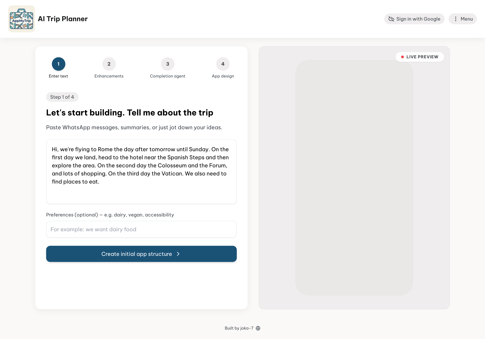
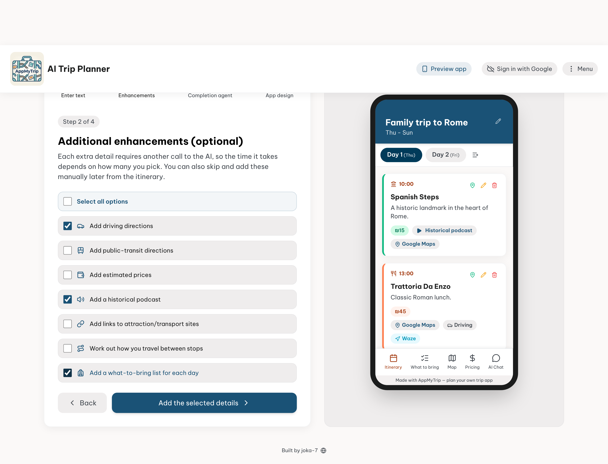
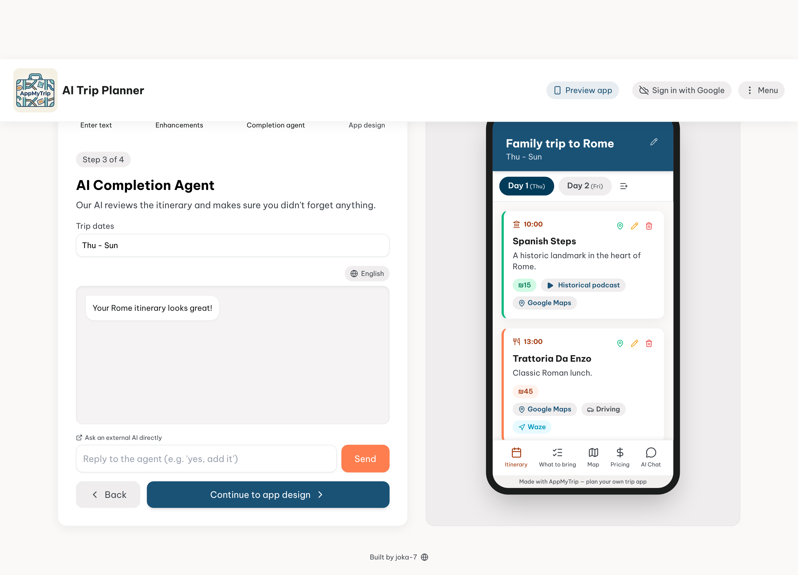
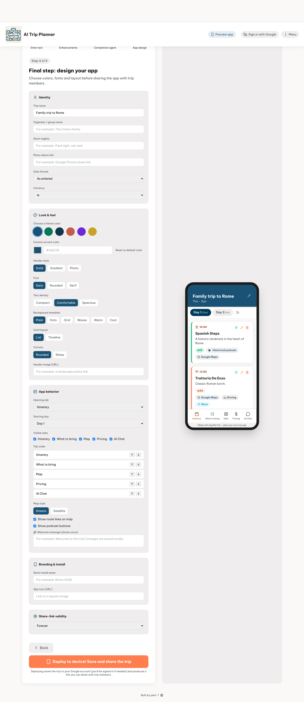
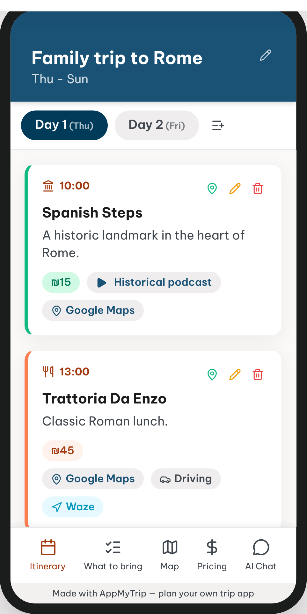
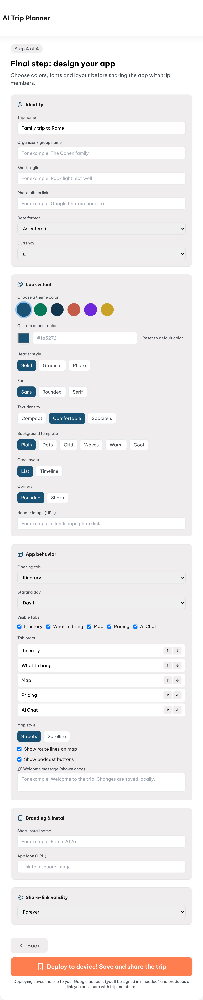
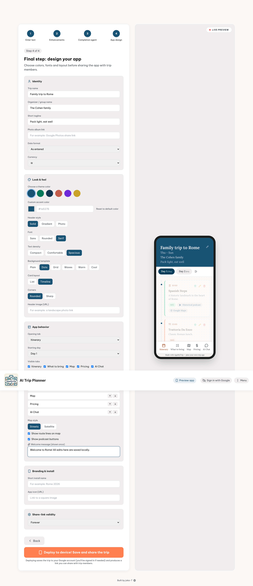
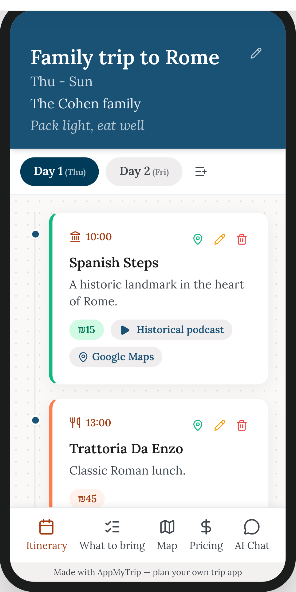
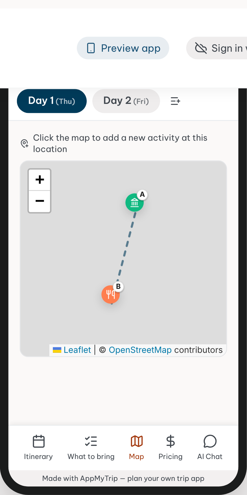
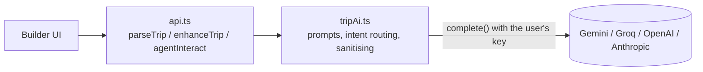

# AppMyTrip

An app that turns a free-text trip summary (e.g. pasted WhatsApp messages) into a
structured, per-day trip app — with day tabs, a map of points of interest, a
"what to bring" checklist per day, turn-by-turn navigation links (Google Maps and
Waze), an AI completion agent, and rich media (historical podcasts). On the web
and as an Android app.

**Status: working web app.** A React web UI walks you through the 4-step build flow
with a live phone preview. The AI steps run in the browser: each call goes from the
user's device straight to their own AI provider, with their own key — there is no
AppMyTrip server. The flow runs end to end — parse, enrich, iterate with the AI
agent, customise and deploy — behind CI (lint, format check, Vitest unit tests,
build, Playwright end-to-end) with grouped Dependabot updates.

**Android app:** the same web app in a Capacitor shell (`frontend/android/`), built
and signed by `.github/workflows/android.yml`. See "Android app" below.

## What you can do with it

- **Turn free text into a trip app.** Paste WhatsApp messages, a rough itinerary, or
  just jot down ideas — the AI structures it into day-by-day stops with times,
  descriptions, and map coordinates (Step 1).
- **Layer on the details you actually want.** Opt in per trip to driving/transit
  directions, estimated prices, a historical audio podcast per site, links to
  attraction/transport sites, an automatically-worked-out travel mode per leg, and a
  what-to-bring packing list — each is one extra AI call, so you only pay
  for what you check (Step 2).
- **Iterate with an AI completion agent.** Chat in plain language ("add a beach
  afternoon on Saturday", "we land Friday morning now") and watch the itinerary
  update live next to the conversation, with a rotating live preview so you see the
  result immediately (Step 3).
- **Design the app your trip members will actually use.** Pick a theme color or
  custom accent, font (sans/rounded/serif), text density, background template, card
  layout (list or timeline), corner style, which tabs are visible and in what order,
  a starting tab/day, and a one-time welcome message — then deploy it to your own
  device with a tap (Step 4).
- **Watch every change live.** A phone-shaped preview mirrors the itinerary, map,
  packing list, pricing, and AI chat tabs as you edit, at every step of the build.
- **Get the right navigation link for every stop**, automatically: Google Maps and
  Waze links per leg, using the travel mode that actually fits that leg (walking,
  driving, transit, cycling, hiking) rather than one mode for the whole day.
- **Never forget what to bring.** An AI-suggested or hand-edited checklist, split
  into trip-wide items and per-day items, with each viewer ticking their own copy.
- **Save, load, and share trips — privately.** Sign in with Google and trips are
  saved to *your own* Google Drive, not to a server we run. Share a link — view-only,
  plus an optional edit link — that is end-to-end encrypted: the key travels in the link itself, so not even the
  app's operator can read a shared trip. Pick an expiry (7/30/90 days, or forever).
- **Bring your own AI key.** Each user supplies their own Gemini, OpenAI, Anthropic,
  or Groq API key from the navbar, so running the app costs its operator nothing. The
  key, the prompt and the itinerary go from the device straight to that provider.
- **Print or export** the itinerary and checklist, or export the trip dates to a
  calendar file.
- **Use it in Hebrew, English, or French**, including full right-to-left layout.

## Screenshots

All screenshots below are the English UI, captured at each step of the 4-step build
flow — the builder panel on the left, with the live phone preview on the right.

**Step 1 — Enter text.** Paste (or type) a free-text description of the trip; the AI
turns it into a structured, day-by-day app:



**Step 2 — Additional enhancements (optional).** Pick which extra details the AI
should fill in — directions, prices, podcasts, links, travel mode, packing list —
and watch them merge into the live preview:



**Step 3 — AI completion agent.** Chat with the AI to fill gaps or make changes
before designing the app; its opening message and your replies show up here:



**Step 4 — App design.** The builder panel on the left updates the live phone
preview on the right as you change theme, fonts, background templates, tab order,
and other options.

| Overview | Live preview (default) |
| --- | --- |
|  |  |

**Design panel** — identity, look & feel, behavior, branding, and deploy:



**Customized trip** — organizer name, tagline, serif font, spacious density, timeline
layout, dots background template, and welcome message:

| Builder with options applied | Phone preview |
| --- | --- |
|  |  |

**Map tab** in the live preview (markers, route lines, day stops):



To regenerate these images locally:

```bash
cd frontend
npm run dev -- --port 5174 --strictPort   # in another terminal
SCREENSHOT_BASE_URL=http://localhost:5174 npx playwright test e2e/screenshots.spec.ts
```

## Structure

<!-- BEGIN GENERATED TREE (depth=1 entries=all) -->
```text
AppMyTrip/
├── .github/
├── .run/           # Shared PyCharm/WebStorm run configurations
├── docs/           # Design documentation
├── frontend/       # Vite + React + TypeScript + Tailwind web app — the 4-step build flow and live…
├── .ai             # Ogen-ai submodule — the shared source of rules, skills and the ai-sync…
├── .gitignore
├── .gitleaksignore
├── .gitmodules
├── AGENTS.md       # The compiled coding rules every AI assistant reads — generated, do not…
├── CLAUDE.md       # Claude Code's copy of AGENTS.md (generated)
├── GEMINI.md       # Gemini CLI's copy of AGENTS.md (generated)
├── LICENSE
├── README.md       # AppMyTrip
├── SECURITY.md     # Security Policy
└── ai-config.toml  # Which rule fragments and target tools ai-sync compiles for this repo
```
<!-- END GENERATED TREE -->

Full annotated tree, every file: [`docs/STRUCTURE.md`](docs/STRUCTURE.md). Generated —
regenerate after adding/renaming a file with:
```bash
python .ai/skills/repo_tree/gen_tree.py --project . --output docs/STRUCTURE.md
python .ai/skills/repo_tree/gen_tree.py --project . --output README.md --max-depth 1
```

## AI — runs on the device, with the user's own key

There is no backend. Parsing free text into a trip (Step 1), the opt-in Step 2
enhancements and the Step 3 chat agent all run in the browser
(`frontend/src/services/tripAi.ts`), calling `complete()` from the
[`modeldispatcher-browser-agent`](https://www.npmjs.com/package/modeldispatcher-browser-agent)
npm package. The prompt, the itinerary and the key go from the device directly to
the user's AI provider; no AppMyTrip server sees them.

Each user supplies their **own** key(s) from the navbar's settings menu
(`SettingsMenu` → `frontend/src/components/AiSettingsPanel.tsx`), stored only in that browser's
`localStorage` (`frontend/src/services/apiKey.ts`). Supported providers: `gemini`,
`groq`, `openai` and `anthropic`. Several keys per provider can be saved; every saved
provider is tried in turn (active one first, `getAllCredentials()`), so a call only
fails once all of them have. Models per provider are fixed in `TRIP_MODELS`
(`tripAi.ts`). There is no server-side rate limiting — there is nothing to
rate-limit; each user's own provider quota applies.

Without a key, the AI settings can switch to the "external" mode
(`frontend/src/services/externalChat.ts`): the app hands its prompt to a free chat
app and the user pastes the reply back in.

`preferences` (e.g. "Vegan", "gluten-free", "חלבי") is a plain free-text field added
to the prompt — there is no hardcoded dietary assumption, no special-cased logic
(e.g. no `is_kosher` field), and nothing stored per account. Saving/loading/sharing
trips is handled entirely client-side too (see "Frontend" → "Trip storage" below).

Podcasts are narrated by the device's built-in speech synthesis
(`frontend/src/hooks/usePodcastPlayer.ts`), reading the activity's description and
its AI-written `podcast_brief`. There is no server-side text-to-speech.

## Frontend

```bash
cd frontend
npm install
npm run dev           # dev server
npm run build         # type-check + production build into dist/
npm run preview       # serve the production build

# lint / format (eslint + prettier)
npm run lint
npm run format
npm run format:check

# run tests (vitest + React Testing Library)
npm run test

# end-to-end tests (Playwright — real browser, real dev server)
npx playwright install chromium   # one-time browser download
npm run test:e2e
```

### Trip storage (save / load / share trips)

The design goal is that the operator cannot read anyone's trips.

**Private trips live in the user's own Google Drive.** Signing in (Google's own
sign-in, scope `drive.appdata`) lets the browser save trips to the Drive
*appDataFolder* — a hidden folder only this app can read, which the user can wipe
any time from Drive's "Manage apps". The browser talks to Google directly; no
AppMyTrip server is in the path (`frontend/src/services/driveSync.ts`). Each
device writes only its own file and reads everyone's, newest edit per trip wins,
and deletes are kept as tombstones so a deleted trip never comes back from another
device. **Sign out** clears the in-progress trip from the device, and **Delete all
my data** (in the cloud menu) unpublishes every share link, deletes the Drive files
and revokes the app's access.

**Share links are end-to-end encrypted.** Sharing encrypts the trip
in the browser (AES-256-GCM, `frontend/src/services/shareCrypto.ts`) and stores
only the ciphertext in Firestore's `sharedTrips` collection. The link looks like
`/?shared=<id>#k=<key>`: the key is in the `#fragment`, which browsers never send
to any server, so neither Firestore, Vercel's logs nor the operator ever see it.
Nothing readable about the trip is in the URL; the native share sheet sends
"trip name — dates" as message text next to the link. Re-sharing keeps the same
link with fresh content. A view link is read-only: a recipient can edit locally,
then save a copy to their own account or share it as a new link.

**Edit links (optional).** From the cloud menu the owner can create an edit link,
`/?shared=<id>#k=<key>&e=<editToken>`: anyone holding it gets "Save changes" on the
shared page and can replace the shared trip for everyone. The edit token is in the
fragment too. Firestore stores only its hash on the share; each save is a batched
write of the new ciphertext plus a write-only receipt (`shareEdits`) carrying the
token, and the rules accept the ciphertext only alongside a fresh receipt, so the
token is never readable by viewers. The owner can turn the edit link off at any
time (the view link keeps working). Sharing again from "My trips" replaces what
editors saved. Add a second TTL policy on `shareEdits.expiresAt` so receipts are
cleaned up after a day.

There is no Firebase sign-in. A share's owner proves ownership with a random token
kept in their own Drive; Firestore stores only its SHA-256, and every update must
present the current token and replace the hash (`frontend/firestore.rules`). The
rules allow fetching one share by id but never listing the collection, so shares
cannot be enumerated.

When sharing, the user picks a link lifetime (7 / 30 / 90 days, or "forever" — the
default). The rules refuse to serve a share past its `expiresAt` or once it is
unpublished. Deleting a trip unpublishes its link first. For automatic deletion of
expired shares, add a **Firestore TTL policy** on `sharedTrips.expiresAt`
(Firebase console → Firestore Database → TTL), which is included in the free plan.

Setup (free, no billing required):
1. **Google Cloud project** (a Firebase project counts as one): enable the
   **Google Drive API**; under OAuth consent screen → Data access add the scope
   `https://www.googleapis.com/auth/drive.appdata` and publish the app; create a
   **Web application** OAuth client with your site's origins (e.g.
   `http://localhost:5173` and the Vercel URL) as Authorized JavaScript origins.
2. **Firestore**: in the [Firebase console](https://console.firebase.google.com/),
   create a Firestore database, then **Rules** → paste `frontend/firestore.rules`
   and publish. Add a Web app under Project settings to get its config.
3. Copy `frontend/.env.example` to `.env.local` and fill in:
   ```bash
   VITE_GOOGLE_CLIENT_ID=...apps.googleusercontent.com
   VITE_FIREBASE_API_KEY=...
   VITE_FIREBASE_PROJECT_ID=your-project
   VITE_FIREBASE_APP_ID=...
   ```

In the app, the cloud icon in the top-right of the navbar lets a user sign in, save
the current trip, browse/load previously saved trips, and share/delete them.

## Deploying

- **Frontend → Vercel** (free Hobby tier): import the repo, set the root directory to
  `frontend/`, build command `npm run build`, output directory `dist`. Add the
  `VITE_GOOGLE_CLIENT_ID` and `VITE_FIREBASE_*` env vars from above in the Vercel
  project settings. This static build is the only thing to deploy: the AI needs no
  configuration, since each user's key goes from their device to their provider. A
  `frontend/vercel.json` is included so SPA routes don't 404 on refresh, and adds a
  few response headers: `X-Content-Type-Options`, `Referrer-Policy`,
  `Permissions-Policy`, and a `Content-Security-Policy-Report-Only` (deliberately
  *report-only* — it logs violations to the browser console without blocking
  anything, since a blocking policy needs to be checked against a real deployment
  first). Its `connect-src` allows Google APIs (`https://*.googleapis.com`, which
  covers Gemini, Drive and Firestore), `https://accounts.google.com` and the
  OpenAI, Anthropic and Groq APIs. Once you've deployed and confirmed no unexpected
  violations show up, consider changing the header key to
  `Content-Security-Policy` to actually enforce it.
- **Old backend project:** earlier versions deployed a FastAPI backend as a second
  Vercel project (root directory `backend/`). Nothing uses it any more; that Vercel
  project can be deleted, along with its env vars and any `VITE_API_URL`
  variable/setting left in the frontend's Vercel project or the GitHub variables.
- **Firestore → Firebase**: no separate deploy step — Firestore is a managed
  service; you only need the project, the Web app config and the security rules from
  the setup steps above.

## Android app

The Android app is the built web app inside a Capacitor shell
(`frontend/capacitor.config.json`, package `io.github.joka7.appmytrip`).
Differences from the web:

- **Google sign-in goes through Android itself**, because Google refuses OAuth
  inside an embedded WebView: `frontend/src/services/nativeGoogleAuth.ts` asks
  Android (via `@capgo/capacitor-social-login`) for the same `drive.appdata`
  token, and renews it silently. `MainActivity.java` hands Google's consent
  result back to that plugin.
- **No service worker and no "Install" button** inside the app: a service worker
  in the APK would keep serving the previous version after an update.
- **Android backup is off** (`allowBackup="false"`), so tokens and the in-progress
  trip are not copied into device backups.

Every push to `main` builds a signed APK and publishes it as a GitHub release
(`android-1.0.<run>`); pull requests get the APK as a workflow artifact. The APK
must be signed with one permanent key, because Google sign-in only works for the
key whose SHA-1 is registered on the Android OAuth client.

One-time setup:
1. **Signing key** (keep the `.jks` and the password in a password manager; never
   commit them):
   ```bash
   read -rs KEY_PASSWORD && export KEY_PASSWORD
   keytool -genkeypair -keystore appmytrip-release.jks -alias appmytrip -keyalg RSA \
     -keysize 4096 -validity 10000 -storepass:env KEY_PASSWORD -keypass:env KEY_PASSWORD \
     -dname "CN=AppMyTrip"
   base64 -w0 appmytrip-release.jks > keystore.b64
   head -c 1900 keystore.b64 > ANDROID_KEYSTORE_B64; tail -c +1901 keystore.b64 > ANDROID_KEYSTORE_B64_2
   keytool -list -v -keystore appmytrip-release.jks -storepass:env KEY_PASSWORD -alias appmytrip | grep SHA1
   ```
2. **GitHub secrets** (Settings → Secrets and variables → Actions → Secrets):
   `ANDROID_KEYSTORE_B64`, `ANDROID_KEYSTORE_B64_2` (the two files above) and
   `ANDROID_KEY_PASSWORD`.
3. **GitHub variables** (same page → Variables): `VITE_GOOGLE_CLIENT_ID`,
   `VITE_FIREBASE_API_KEY`, `VITE_FIREBASE_PROJECT_ID`, `VITE_FIREBASE_APP_ID` —
   the same public values the web build uses.
4. **Android OAuth client** in the same Google Cloud project: package
   `io.github.joka7.appmytrip` and the SHA-1 printed in step 1. Nothing from it goes
   back into the code; the app uses the Web client ID.

Local build (needs the Android SDK): `cd frontend && npm run build && npx cap sync
android`, then open `frontend/android` in Android Studio.

## How the AI steps connect

The UI calls the AI steps through `frontend/src/api.ts`, which runs them on the
device via `frontend/src/services/tripAi.ts`:



- Step 1 "create app structure" → `parseTrip`
- Step 2 opt-in enhancements → `enhanceTrip`
- Step 3 agent chat → `agentInteract`
- Step 3 → 4 "continue to design" → no AI call

Activities added later in Step 3 (via the chat agent or the live preview's "+"
button) automatically re-run the Step 2 enhancements the user checked, so new
stops get the same directions/prices/podcast-briefs/links without revisiting
Step 2. The two whole-trip options (`packing`, `travel_mode`) are excluded from
that per-activity top-up: `packing` writes day- and trip-level lists that the
per-activity merge would discard, and `travel_mode` is inferred locally for free.

### Navigation links (Google Maps + Waze)

A day is not one mode of travel. A realistic day drives to a trailhead, hikes,
takes a bus back and walks to dinner — so the mode belongs to the **leg** between
two stops, and each stop's card carries its own directions link in its own mode.
There is deliberately **no whole-day route link**: Google Maps applies a single
`travelmode` to an entire route, so one day-long link is wrong for most of its
legs whichever mode it picks.

`frontend/src/services/travelMode.ts` works the mode out from the activity itself
first — a bus/train/ferry is transit, a trail/trek is hiking, an explicit ride is
cycling — and only falls back to distance when the activity says nothing: under
1.5km straight-line is walking, anything further is driving. It never guesses
cycling from distance, and the first stop of a day gets no mode at all, since
there is no leg into it. An explicit `travel_mode` on the activity (set by hand in
the edit form, or by the opt-in Step 2 enhancement) always wins. Hiking is an
app-level distinction: Google has no hiking mode, so its links travel as walking.

Waze appears only on a genuine driving leg — it has no walking, cycling or
transit mode, so offering it anywhere else would send people the wrong way.

Map links are built from coordinates, never from a place name — Google's text
search will happily resolve a common name to a different, same-named place. When
the AI's coordinates are wrong anyway, pasting a Google Maps link into an
activity's "Google Maps link" field overrides the generated link, and if the
pasted link carries coordinates it repairs the map pin too (so the in-app map and
the directions links get fixed as well). A shortened `maps.app.goo.gl` link has no
coordinates to extract and can't be resolved from the browser, so it overrides the
link only — and because that means the pin is still wrong, the coordinate-derived
links (Waze, directions) are hidden for that stop rather than sending you
somewhere you've already said is wrong. Drag the pin on the edit form's mini-map
to fix those too.

### "What we need" checklist

A bottom tab listing what to bring, split into a trip-wide section (documents,
chargers) and one per day (boots for a trail day, a swimsuit for a beach day).
Items are edited by hand and can be pre-filled by the AI — either via Step 2's
"packing" option or the tab's own "AI suggestions" button, which merges
suggestions in by text so it never overwrites what you already wrote. Ticking an
item is stored per viewer in `localStorage`, not in the trip: everyone sharing a
link sees the same list but packs their own bag, and a read-only viewer can still
use it. Like the itinerary, the checklist is included when the trip is printed.

Whole days can also be added, deleted, and reordered (move earlier/later, or
jump to the start/end) from the "manage days" panel next to the day tabs in
the live preview — entirely client-side, no AI call involved.

If parsing fails (no key saved, the provider unreachable or rate-limited), the UI
shows a notice and loads a sample trip so the app stays demoable. A failed chat turn
leaves the itinerary unchanged and offers a Retry button.

To run it: start the frontend (`npm run dev`) and save your own AI key in the
navbar's AI settings.

## IDE run configurations

`.run/` contains a shared WebStorm/PyCharm run configuration (the VCS-friendly
alternative to per-user `.idea/` files, which stay gitignored):
- **Frontend (npm dev)** — runs the Vite dev server

It assumes a Node interpreter configured in the IDE's Node settings.

## Notes

- Design docs: [`docs/HLD.md`](docs/HLD.md) (architecture) and
  [`docs/LLD.md`](docs/LLD.md) (module-level detail).
- Parsing, enhancing and chatting need an AI key — Gemini and Groq have free tiers
  (see "AI — runs on the device" above), or use the keyless "external" mode.
- Dietary/other preferences are entered as free text in the builder UI and added to
  the prompt — not a hardcoded assumption, not stored server-side (see
  "AI — runs on the device" above and "Trip storage" under "Frontend").
- Everything in this app is free to run, with no billing account anywhere: each
  user's own AI key (Gemini and Groq have free tiers), the device's built-in speech
  synthesis for podcasts, Vercel's Hobby tier for the static frontend, Firebase's
  Spark plan for Firestore, and each user's own Google Drive for their trips.
