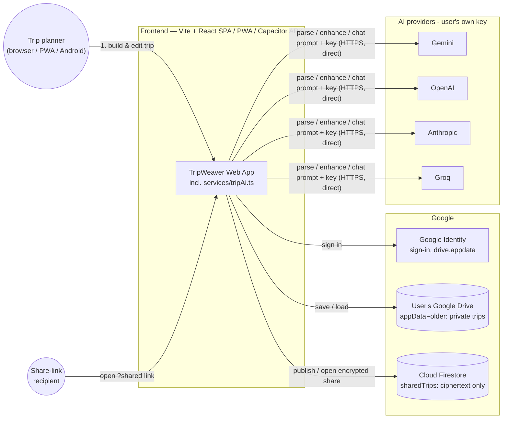
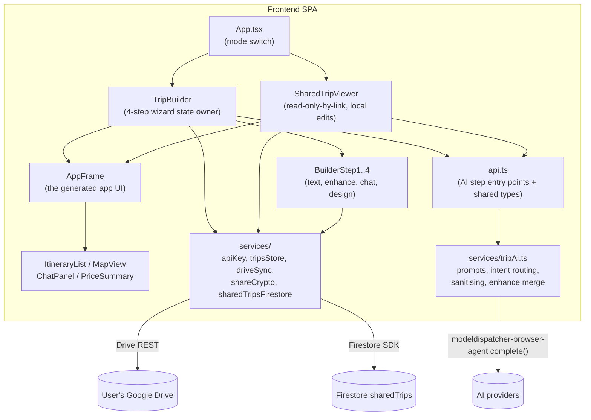
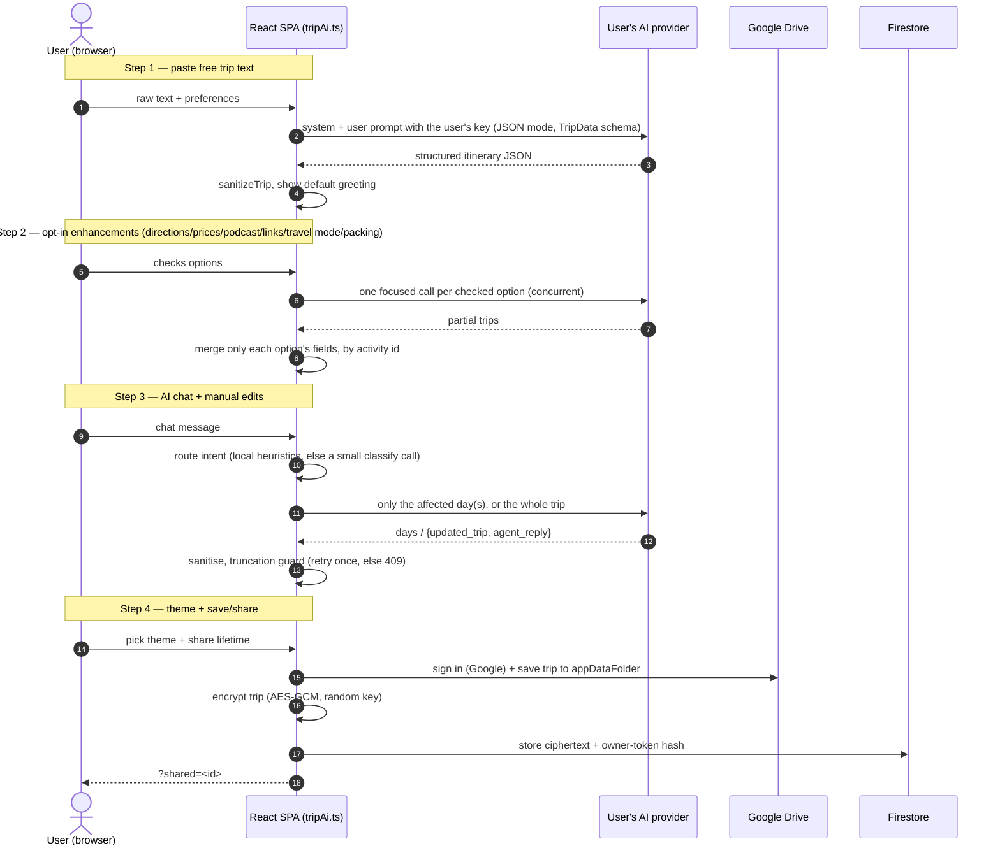
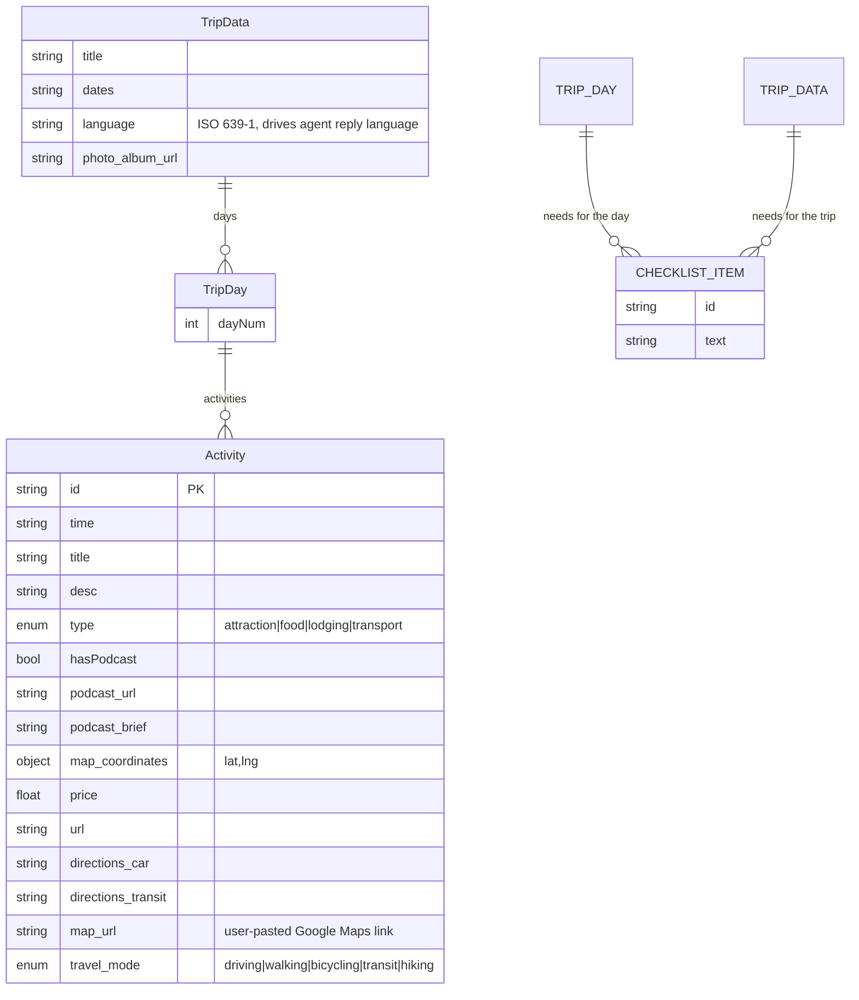
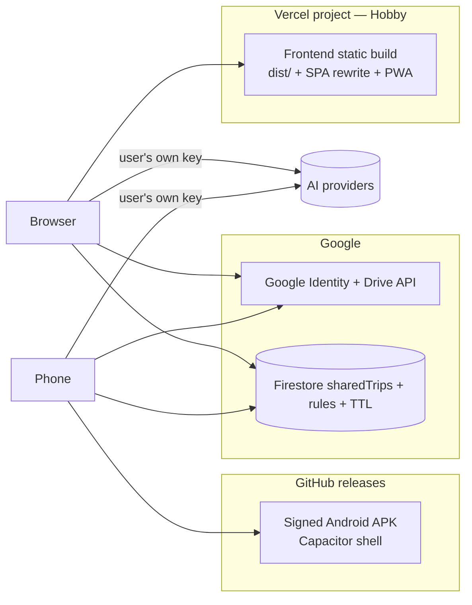

# AppMyTrip — High-Level Design (HLD)

> Scope: the current **TripWeaver AI** prototype in this repository — a Vite +
> React + TypeScript web client (also shipped as a Capacitor Android APK) that turns
> free trip text into a structured itinerary by calling the user's own AI provider
> straight from the device, walks the user through a 4-step build flow with a live
> phone preview, then saves trips to the user's own Google Drive and shares them as
> end-to-end encrypted links. There is no backend.

Companion document: [`docs/LLD.md`](./LLD.md) (Low-Level Design).

---

## 1. Purpose & Product Vision

AppMyTrip turns a free-text trip summary (e.g. pasted WhatsApp messages) into a
structured, per-day trip app: day tabs, a map of points of interest, an AI
completion agent, and rich media (historical "podcasts"). On the web and as an Android app (Capacitor shell).

Core product goals that shape the architecture:

| Goal | Architectural consequence |
|------|---------------------------|
| **Zero running cost** | No server or database we operate; static frontend on Vercel Hobby + Firestore Spark + user's own Drive + each user's own AI key |
| **Operator can't read trips** | Private trips in the user's Drive appDataFolder; shares stored as ciphertext with the key in the link's `#fragment`; AI calls go device → provider |
| **Bring-your-own LLM key** | Keys live only in the user's `localStorage` and are sent only to that provider (`services/apiKey.ts`, `services/tripAi.ts`) |
| **Always demoable** | Client falls back to a local sample trip when parsing fails (no key, provider down) |
| **No backend** | AI runs in the browser (`modeldispatcher-browser-agent`); the only deployables are the static build, Firestore rules and the Android APK |
| **Multilingual / RTL first** | UI is Hebrew/RTL; the LLM detects and echoes the trip's dominant language |

---

## 2. System Context

**Key point:** the browser talks to independent services — the user's own **AI
provider** (with the user's own key), the user's own **Google Drive** (private
trips) and **Firestore** (encrypted shares). They never talk to each other; the
browser is the only thing that knows about all of them. AppMyTrip runs no server:
nothing the operator controls sees a prompt, a key or a readable trip.

---

## 3. Container / Component View

### 3.1 Frontend containers

| Container | Responsibility |
|-----------|----------------|
| `App.tsx` | Chooses **builder mode** vs **shared-viewer mode** from the `?shared=<id>` URL param; owns all trip state and mutation handlers |
| `BuilderStep1..4` | The wizard: (1) paste text, (2) opt-in enhancements, (3) AI chat + edit, (4) theme + save/share |
| `AppFrame` | The actual "generated app" (header, day tabs, itinerary/map/price/chat tabs, podcast player, bottom nav). Reused by the live preview and the shared page. A "manage days" panel on the day-tab bar adds/deletes/reorders whole days (move earlier/later, jump to start/end). A small "Made with AppMyTrip" attribution strip below the bottom nav links back to the builder's own origin, in the current UI language |
| `api.ts` | The three AI entry points (`parseTrip`, `enhanceTrip`, `agentInteract`), wired to `createTripAi({ complete })`; re-exports `ApiError`; the single source of truth for the shared `TripData`/`Activity` TypeScript types |
| `services/tripAi.ts` | The AI steps themselves: prompts, chat-turn intent routing, truncation guard, per-extra enhancement merge, and `sanitizeTrip`, which turns every AI reply (untrusted) into a well-formed `TripData` |
| `services/*` | `apiKey` (BYO keys in localStorage), `tripsStore` (save/load/share), `driveSync` (Drive appDataFolder sync), `shareCrypto` (AES-GCM share links), `sharedTripsFirestore` (ciphertext store), plus helpers (`hebrewDate`, `language`, `tripFile`, `env`) |

---

## 4. End-to-End Flow (the 4-step build)

The AI steps map 1:1 to product stages:

| Stage | UI | Call (`frontend/src/api.ts`) | AI? |
|-------|----|------------------------------|-----|
| 1. Parse | `BuilderStep1` | `parseTrip` | yes |
| 2. Enhance | `BuilderStep2` | `enhanceTrip` | yes (opt-in) |
| 3. Agent chat | `BuilderStep3` / preview chat | `agentInteract` | yes |
| 3→4. Continue | "continue to design" | — | no |
| 4. Save/share | `BuilderStep4` / `CloudMenu` | Google Drive + Firestore | no |

---

## 5. Data Model

The whole system revolves around one document — `TripData` — sent in every AI
prompt, stored in the user's Drive, and (encrypted) in a share. There is no relational schema.

- **`Activity.id`** is the merge key across every flow: enhancement, agent
  updates, and manual edits all reconcile activities by `id`, never by position.
- The **base fields** (`id`, `time`, `title`, `desc`, `type`, `map_coordinates`)
  come from parse/chat; the **enrichment fields** (`price`, `url`, `directions_*`,
  `hasPodcast`, `podcast_brief`) are filled only by the opt-in Step 2
  enhancement, keeping the default parse fast. `podcast_url` is only ever set on
  trips saved before the AI moved on-device; `sanitizeTrip` writes it as `null`.
- The TypeScript `TripData`/`Activity` interfaces in `frontend/src/api.ts` are the
  one contract. The JSON schemas embedded in prompts (`frontend/src/data/*.json`)
  must stay in step with them, and `sanitizeTrip` (`services/tripAi.ts`) rebuilds
  every AI reply field by field — a field it doesn't copy is dropped on every
  parse/chat round-trip.
- **`Activity.map_url`** is a user override for when the AI's coordinates land on
  the wrong place. Pasting a Maps link both replaces the "open in Google Maps"
  target and, when the link carries coordinates, repairs `map_coordinates` — so
  the in-app pin and the directions links get corrected too. When the pasted link
  is a shortened one (no coordinates, unresolvable from the browser) the pin stays
  wrong, so everything derived from it is hidden rather than offered.
- **`Activity.travel_mode`** describes the *leg into* a stop, not the stop and
  not the day: a real day mixes driving, walking, hiking and buses, so each leg
  is decided on its own and the first stop of a day has no mode at all. Normally
  unset and inferred (`frontend/src/services/travelMode.ts`) from the activity
  itself first — a bus/ferry is transit, a trail is hiking — falling back to
  distance only when the activity says nothing; an explicit value is a user or AI
  override that always wins. It decides which links a stop offers: Waze only on a
  driving leg, since it has no walking/cycling/transit mode. There is no
  whole-day route link, because Google Maps applies one `travelmode` to an entire
  route and would therefore be wrong for most legs of a mixed day.
- **Checklists** ("what we need") hang off both `TripDay` and `TripData`: per-day
  items for that day's activities, trip-wide items for documents and chargers.
  Tick state is deliberately *not* in the model — it lives in each viewer's
  localStorage, so a shared link works read-only and one person packing doesn't
  tick the box for everyone.
- **`TripDay.dayNum`** is kept as a gapless `1..N` sequence matching array order —
  day tabs, `icsExport`'s per-day calendar-date math, and the Hebrew weekday
  labels all key off it. `frontend/src/hooks/useTripEditing.ts` renumbers it after
  every add/delete/reorder of a day.

---

## 6. Key Design Decisions

### 6.1 No backend, browser-owned state
There is no AppMyTrip server: no session, DB, or per-user data that we run. The
current `TripData` is the client's state; the AI steps run in the browser
(`services/tripAi.ts`), persistence is in the user's own Google Drive, and shares
are ciphertext in Firestore. The only deployables are the static build, the
Firestore rules and the Android APK.

### 6.2 Bring-your-own LLM key (BYO), device → provider
Each user stores their own provider key(s) in `localStorage`
(`services/apiKey.ts`); `getAllCredentials()` lists every saved provider, active one
first, and `agentConfigFrom` turns that into the dispatcher's fallback list. The
call goes straight from the device to the provider; no key is ever configured by the
operator. Only `gemini`, `groq`, `openai` and `anthropic` are supported (`SUPPORTED`
in `tripAi.ts`); others are skipped. No saved key → `ApiError(401)`.

### 6.3 Provider access via `modeldispatcher-browser-agent`
Provider HTTP calls, key rotation and provider fallback live in the
`modeldispatcher-browser-agent` npm package (`complete()`), injected into
`createTripAi({ complete })` from `api.ts` so tests can pass a fake. The app only
picks a model per provider (`TRIP_MODELS`), an output budget per call shape
(`MAX_TOKENS_*`), and maps the package's errors to `ApiError` statuses (`classify`).

### 6.4 Generic free-text preferences (no special-cased dietary logic)
`preferences` is an optional plain-text field (e.g. "Vegan", "gluten-free") sent
with parse/agent calls and injected into the LLM prompt as-is. There is no
`is_kosher` field on activities and no proactive nudge after parse — `parseTrip`
always returns `initial_agent_message: null`; the frontend shows a default
greeting instead.

### 6.5 Concurrent, per-option enhancement
Step 2 fires **one small LLM call per checked option**, run concurrently
(`Promise.allSettled`), plus one for activities missing `map_coordinates`, then
merges each result by activity `id` / `dayNum`, only for that option's fields and
never overwriting a value with an empty one. Rationale: checking every option stays
about as fast as checking one, and a single failed/rate-limited option doesn't sink
the others — only a total failure throws.

### 6.6 Re-apply enhancements to newly added activities
The frontend remembers the Step 2 checkbox selections (`enhanceOptions`) and
re-runs them via `enhanceActivities` (`services/tripEnhance.ts`) whenever
activities are added later — by the Step 3 chat agent (`App.tsx`, where
`findNewActivities` diffs by `id`) or manually via the live preview's "+" button
(`hooks/useTripEditing.ts`). Only the new activities are sent to `enhanceTrip`, as a one-day trip, then
results are merged back by `id`. `packing` and `travel_mode` are left out of this
top-up (see `ALL_ENHANCE_OPTIONS`).

### 6.7 Resilience guards
- **Scoped chat edits**: a chat turn that only adds days or touches specific days
  sends just those days to the model (smaller output, less to drop); any scoped
  reply that doesn't check out (`422`) falls back to the whole-trip turn.
- **Truncation guard** (`looksTruncated`): a chat turn whose reply drops more than
  65% of an itinerary with at least 6 activities is retried once, then rejected with
  `409` (the itinerary is left unchanged), unless the user asked to delete things.
  This defends against the LLM hitting a token limit mid-echo.
- **Retries / fallback**: `modeldispatcher-browser-agent` retries a 429/5xx or
  network failure once and falls through the saved keys and providers; when all
  fail, `classify` reports `429` (all rate-limited or out of quota), `413` (request too
  large), `401` (no key worked) or `502`.
- **Client fallback**: a failed parse loads a local demo trip plus a dismissible
  notice; a failed chat turn keeps the itinerary and offers Retry; a failed
  enhancement keeps the current trip, so the prototype stays live.

### 6.8 Persistence & sharing model (private by design)
Private trips live in the user's Google Drive appDataFolder (`driveSync.ts`, ported
from KanDOne): one file per device, newest edit per trip wins, deletes kept as
tombstones. Sharing encrypts `{trip, appDesign}` with AES-256-GCM in the browser
and stores only `{ciphertext, iv, ownerTokenHash, expiresAt}` in
`sharedTrips/{shareId}`; the link is `?shared=<id>#k=<key>`. View links are
read-only; an optional edit link (`&e=<editToken>`) lets its holders replace the
ciphertext through a batched write with a write-only `shareEdits` receipt, so the
edit token is never stored where viewers can read it. There is no Firebase sign-in: the owner proves ownership with a token
kept in their Drive, and every update must present it and rotate its hash
(`firestore.rules`). Rules allow `get` but never `list`, and refuse expired or
unpublished shares. Deleting a trip unpublishes its share first; "Delete all my
data" unpublishes every share, deletes the Drive files and revokes access.

### 6.9 Rich media without a media pipeline
There is no TTS service. "Podcasts" are narrated by the device's built-in speech
synthesis (`usePodcastPlayer`, Web Speech API), reading the activity's `desc` plus
its AI-written `podcast_brief`. A `podcast_url` on an older saved trip is still
played as audio, falling back to speech if it fails to load.

---

## 7. Deployment View

- **Frontend → Vercel** static build (`npm run build` → `dist/`), SPA rewrite via
  `vercel.json`, PWA via `vite-plugin-pwa`. Config through `VITE_*` env vars
  (Google client ID, Firebase web config — all public); the AI needs none.
- **Android** → `.github/workflows/android.yml` builds and signs the APK and
  publishes it as a GitHub release.
- **Google Cloud / Firebase**: a Web OAuth client with the `drive.appdata` scope,
  the Drive API enabled, and Firestore with the published security rules.

---

## 8. Cross-Cutting Concerns

| Concern | Approach |
|---------|----------|
| **Security** | No server of ours, so no secrets of ours; private trips only in the user's Drive; shares are ciphertext, fetchable by id but never listable, writable only with the owner token; API keys live only in the user's `localStorage` and are sent only to their AI provider; every AI reply is untrusted and rebuilt by `sanitizeTrip`; `vercel.json` ships a report-only CSP whose `connect-src` lists Google APIs and the OpenAI, Anthropic and Groq APIs |
| **Error handling** | One contract: `ApiError(status, detail)` from `services/tripAi.ts` (`401` no usable key, `409` reply dropped most of the trip, `422` reply not a valid trip, `413` request too large, `429` every key rate-limited, `502` every provider failed); `App.tsx`'s `describeApiError` turns it into a localized notice and the UI degrades gracefully |
| **i18n / RTL** | UI is Hebrew/RTL (`dir="rtl"`) by default; the LLM detects the trip's dominant language, sets `TripData.language`, and replies in it; `LanguageIndicator` surfaces it. `LanguageSwitcher` (he/en/fr) is available in the builder navbar and, since a shared-link visitor is a different person from the builder with their own preference, in `SharedAppPage` too. A first-time shared-link visitor with no stored preference gets the UI defaulted to the trip's own `language` (`setLangIfUnset`) rather than the hardcoded Hebrew fallback; an explicit choice — the builder's or a returning visitor's — is never overridden |
| **Offline / PWA** | Installable PWA (manifest + Workbox precache); the demo-trip fallback keeps it usable when no provider is reachable |
| **Performance** | Default parse/chat stay lean (enrichment deferred to opt-in Step 2); chat edits are scoped to the affected days when possible; enhancement calls run concurrently |
| **Observability** | Prototype-level: client logs to console; a `502`'s detail (which provider failed and why) is shown in the app. No metrics/tracing |

---

## 9. Quality Attributes & Constraints

- **Cost:** must run at $0 — satisfied by free tiers + BYO key + on-device speech.
- **Availability:** best-effort; a static site plus managed Google services and the
  user's AI provider, no HA requirement.
- **Scalability:** no server of ours; each user is bounded by their own provider
  quota.
- **Portability:** a standard Vite SPA, also wrapped as a Capacitor Android app.
- **Data privacy:** the operator holds no readable trip: private trips are in the
  user's own Google Drive, shared trips are ciphertext whose key exists only in the
  link, and prompts go from the device straight to the user's AI provider.

---

## 10. Risks, Limitations & Future Work

| Area | Current limitation | Possible next step |
|------|--------------------|--------------------|
| LLM reliability | Whole itinerary re-echoed on unscoped chat turns (token-limit risk, mitigated by scoping + guard) | Diff-based agent updates |
| Persistence | Lives in each user's Drive; no copy we control (by design) | Export/import already exists (`tripFile`) |
| Media | Podcast voice quality depends on the device's installed speech voices | — |
| Auth scope | Google sign-in only (Drive is the store) | — |
| Shared editing | One edit link per share: anyone holding it can edit; last save wins | Per-editor key wrapping for named editors |
| Testing | Unit + e2e exist; no load/perf tests | Contract test between the TS types and the prompt JSON schemas |
| Android | Capacitor shell, sideloaded APK from GitHub releases | Play Store listing |

---

## 11. References

- Low-Level Design: [`docs/LLD.md`](./LLD.md)
- Directory map: [`docs/STRUCTURE.md`](./STRUCTURE.md) (generated)
- Trip contract + AI entry points: `frontend/src/api.ts`
- AI steps: `frontend/src/services/tripAi.ts`, prompt schemas in `frontend/src/data/`
- BYO keys: `frontend/src/services/apiKey.ts`
- Podcast playback: `frontend/src/hooks/usePodcastPlayer.ts`
- Frontend shell: `frontend/src/App.tsx`, `frontend/src/components/AppFrame.tsx`
- Storage/sharing: `frontend/src/services/tripsStore.ts`, `driveSync.ts`, `shareCrypto.ts`, `sharedTripsFirestore.ts`, `frontend/firestore.rules`
- Project overview: `README.md`
