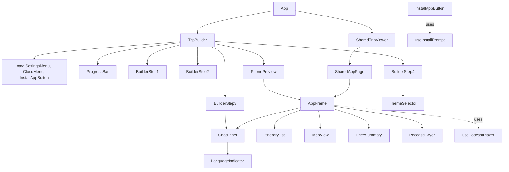
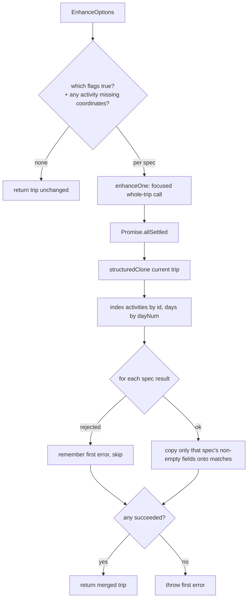
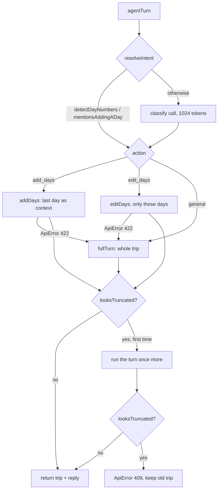
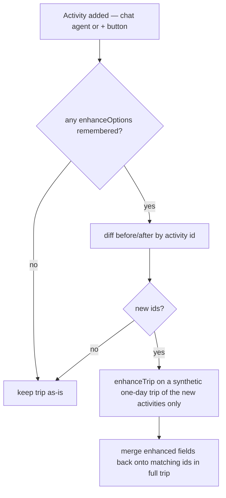

# AppMyTrip — Low-Level Design (LLD)

> Component-level design of the **TripWeaver AI** prototype: exact modules,
> functions, data contracts, and control flow of the React frontend — including
> the AI steps, which run in the browser (`frontend/src/services/tripAi.ts`).
> There is no backend.

Parent document: [`docs/HLD.md`](./HLD.md) (High-Level Design).

---

## 1. Directory Structure

The annotated file tree is generated into [`docs/STRUCTURE.md`](./STRUCTURE.md);
this document doesn't keep a second, hand-written copy. Section 9 below is a
quick jump to the files each concern lives in.

---

## 2. AI LLD (`frontend/src/services/tripAi.ts`)

### 2.1 Wiring and contracts

`api.ts` is the composition root: it builds one instance with
`createTripAi({ complete })`, passing `complete` from `modeldispatcher-browser-agent`
(tests inject a fake `CompleteFn`), and converts the saved keys with
`agentConfigFrom(credentials)` on every call.

| Export | Signature | Contract |
|--------|-----------|----------|
| `CompleteFn` | `(cfg: AgentConfig, prompt: string, options?: RequestOptions) => Promise<string>` | The injected provider call; `tripAi` always passes `{ systemInstruction, jsonMode: true, maxTokens }` |
| `ProviderKeys` | `{ provider: string; api_keys: string[] }` | One saved provider and its keys (`getAllCredentials()` in `services/apiKey.ts`) |
| `agentConfigFrom` | `(credentials: readonly ProviderKeys[]) => AgentConfig` | Keeps only `gemini`/`openai`/`anthropic`/`groq` entries with ≥1 key, in order, each with its `TRIP_MODELS` model; `ollamaUrl: ""` |
| `createTripAi` | `({ complete }) => { parseTripText, agentTurn, enhanceTrip }` | Factory; no module-level state |
| `parseTripText` | `(rawText, preferences, cfg) => Promise<TripData>` | Free text → sanitised trip |
| `agentTurn` | `(trip, message, preferences, cfg) => Promise<{ trip, reply }>` | One chat turn, scoped when safe, truncation-guarded |
| `enhanceTrip` | `(trip, options: EnhanceOptions, cfg) => Promise<TripData>` | Opt-in extras merged into a copy of `trip` |
| `sanitizeTrip` | `(value: unknown) => TripData` | Rebuilds a trip from an untrusted reply; `422` when it has no object or no `days` array |
| `extractJson` | `(text: string) => unknown` | Parses the reply, tolerating a code fence or prose around the outermost `{…}`; `422` otherwise |
| `detectDayNumbers`, `mentionsAddingADay`, `mentionsDeletion`, `looksTruncated` | pure heuristics | See 2.3 / 2.4 |

The public wrappers in `api.ts` keep the old response shapes:
`parseTrip(rawText, preferences, credentials)` → `{ trip_data, initial_agent_message: null }`,
`agentInteract(tripData, userMessage, preferences, credentials)` → `{ trip_data, agent_reply }`,
`enhanceTrip(tripData, options, credentials)` → `{ trip_data }`.

**Constants.** Output budgets `MAX_TOKENS_CLASSIFY = 1024`,
`MAX_TOKENS_SCOPED_EDIT = 8192`, `MAX_TOKENS_FULL_TRIP = 16384` (some providers,
Groq notably, reject a request asking for more than the model allows).
`TRIP_MODELS`: `gemini-2.5-flash`, `gpt-4o-mini`, `claude-sonnet-4-5-20250929`,
`openai/gpt-oss-120b` (Groq). Every prompt embeds a JSON schema from
`frontend/src/data/` (`tripDataSchema`, `agentResponseSchema`,
`agentScopedResponseSchema`, `agentDayIntentSchema`).

### 2.2 Untrusted replies — `sanitizeTrip`

Every reply goes through `extractJson` and then `sanitizeTrip` (or, for scoped
edits, `sanitizeDays`) before anything uses it. Each field is rebuilt from a typed
read: strings are length-capped, numbers must be finite, `map_coordinates` must be
within ±90/±180, an unknown activity `type` becomes `"attraction"`, an unknown
`travel_mode` becomes `null`, `podcast_url` is always `null`, a missing
`dayNum` becomes its index + 1, `language` defaults to `"he"`. Limits: 120 days,
150 activities per day, 100 checklist items. Anything not shaped like a trip →
`ApiError(422)`.

### 2.3 Chat turn — intent routing and scoped edits

```text
agentTurn(trip, message):
  result = agentTurnOnce(trip, message)
  if looksTruncated(trip, result.trip, message):
      result = agentTurnOnce(trip, message)          # one retry
      if looksTruncated(...): throw ApiError(409)
  return result

agentTurnOnce:
  intent = resolveIntent(trip, message)
  try:
    add_days                       -> addDays   (sends title/dates/day count/last day; new days only)
    edit_days with day numbers     -> editDays  (sends only those days; replaces them by dayNum)
  catch ApiError(422): fall through   # other errors (401/429/502) propagate
  return fullTurn                     # whole itinerary in, {updated_trip, agent_reply} out

resolveIntent:
  n = detectDayNumbers(message)       # "day 8" / "יום 8" / "jour 8"
  if n: all new -> add_days; all existing -> edit_days(n); mixed -> classify
  elif mentionsAddingADay(message): add_days
  if trip has no days: general
  classify: one call (MAX_TOKENS_CLASSIFY) with a one-line summary per day;
            any failure or odd reply -> general
```

Scoped replies are rejected with `422` (and so fall back to `fullTurn`) when they
have no days, when `addDays` returns a `dayNum` that already exists, or when
`editDays` returns a day it wasn't asked for. `fullTurn` substitutes a default
reply text ("בוצע!" / "Done!") when `agent_reply` is missing rather than failing
the edit.

### 2.4 Truncation guard — `looksTruncated(previous, updated, message)`

`true` when the message contains no deletion keyword (`mentionsDeletion`: a
multilingual word list matched on Unicode-aware word boundaries, plus substring
matches for Chinese/Japanese/Korean), the previous trip had at least 6 activities,
and the reply kept fewer than 35% of them.

### 2.5 Enhancement — `enhanceTrip(trip, options, cfg)`

`ENHANCE_SPECS` holds one entry per option (`directions_car`, `directions_transit`,
`prices`, `podcast`, `links`, `travel_mode`, `packing`): its instruction and the
fields it may write (`activityFields`, `dayFields`, `tripFields`). The selected
specs, plus `MISSING_COORDINATES` whenever any activity lacks `map_coordinates`,
each make one whole-trip call, all run concurrently with `Promise.allSettled`. The
results merge into a `structuredClone` of the trip: activities matched by `id`,
days by `dayNum`, only that spec's fields, and only when the new value is non-empty
(`hasValue`), so a reply never erases an existing value; `MISSING_COORDINATES`
never touches an activity that already has coordinates. It throws the first error
only when every call failed; no option selected and nothing missing → the trip is
returned unchanged.

### 2.6 Error contract

One error type: `ApiError(status, detail)` (`tripAi.ts`, re-exported by `api.ts`).
`classify` maps the dispatcher's failures; the AI steps raise the rest.

| Status | Raised by | Meaning |
|--------|-----------|---------|
| `401` | `classify` | `NoProviderConfiguredError` (no usable key saved), or every provider attempt failed with 401/403/key errors |
| `409` | `agentTurn` | the reply still dropped most of the trip after one retry |
| `422` | `extractJson`, `sanitizeTrip`, scoped-reply checks | the reply was not valid JSON / not a trip / not the days asked for |
| `429` | `classify` | every attempt failed with a rate limit |
| `502` | `classify` | every provider failed otherwise; `detail` lists `provider: error` per attempt |

`App.tsx`'s `describeApiError` turns the status into a localized message (and
appends `detail` for `502`). Provider HTTP, the per-request timeout, one retry on
429/5xx and key/provider fall-through live in `modeldispatcher-browser-agent`.

---

## 3. Frontend LLD

### 3.1 State ownership (`App.tsx`)

`App` renders `SharedTripViewer` when the URL has `?shared=<id>`, else `TripBuilder`.

**`TripBuilder`** owns the wizard state and every mutation handler:

| State | Meaning |
|-------|---------|
| `step` (1–4) | current wizard step; mirrored into `history.pushState` so device Back navigates steps, not out of the app |
| `rawText`, `preferences`, `theme` | Step 1/4 inputs |
| `tripData` | the working trip (starts `EMPTY_TRIP`) |
| `tripId` | Drive record id once saved/loaded (`null` = unsaved → next save creates new) |
| `agentMessages` | chat transcript |
| `enhanceOptions` | remembered Step 2 toggles, re-applied to newly added activities |
| `isProcessing/isEnhancing/isSendingMessage` | per-call loading flags |
| `apiNotice` | dismissible localized fallback banner |

Handlers: `handleProcessText` (parse, fallback → `buildDemoTrip()`), `handleEnhance`,
`handleSendMessage` (agent; on failure a chat notice + Retry, trip unchanged), and
after each agent turn `findNewActivities` + `enhanceActivities`
(`services/tripEnhance.ts`) — diffs by activity `id`, re-runs the remembered
enhancements only on newly added activities, then merges by `id`. Step 3's
"continue" just moves to Step 4.
`hooks/useTripEditing.ts` — shared by both the builder preview and the
shared-viewer below, since both mutate a `TripData` via a `setTrip` callback —
also exposes `handleAddDay` (append an empty day), `handleDeleteDay(index)`,
and `handleMoveDay(fromIndex, toIndex)` — one primitive covering
move-earlier/later and jump-to-start/end — all of which renumber `dayNum` back
to a gapless `1..N`.

**`SharedTripViewer`** is deliberately **local-only**: it loads the trip via
`loadSharedTrip`, keeps its own `trip`/chat state, and its handlers only call
`setTrip` — it never imports `saveTrip`/`shareTrip`, so edits stay in the browser.
On load it also calls `setLangIfUnset(result.trip.language)` (from
`i18n/store.ts`) — a no-op unless the visitor's browser has no stored
`appmytrip_lang` yet, in which case the UI defaults to the trip's own language
instead of the hardcoded Hebrew fallback.

### 3.2 `api.ts` — AI entry points

- Shared TS interfaces: `Activity`, `TripDay`, `TripData`, `EnhanceOptions`, and the response types (`ParseResponse`, `AgentResponse`, `EnhanceResponse`) — the one trip contract.
- `const tripAi = createTripAi({ complete })` — the only place the dispatcher is wired in.
- Functions: `parseTrip`, `agentInteract`, `enhanceTrip` — each takes `credentials: readonly ProviderKeys[]` last and delegates to `tripAi` (see 2.1).
- Re-exports `ApiError` (see 2.6).

### 3.3 Component composition



### 3.4 Component reference

| Component | Purpose / key props | Notable behavior |
|-----------|---------------------|------------------|
| `AppFrame` | The generated-app UI (header, day tabs, 4 content tabs, bottom nav). Props: `tripData`, `theme`, chat props, `onUpdateActivity/onAddActivity/onUpdateTrip`, `onAddDay/onDeleteDay/onMoveDay`, `isLocalOnly` | Owns `activeDay`, `activeTab`, `focusActivityId`, header edit drafts, `isManagingDays`; uses `usePodcastPlayer`; empty-state safe; theme → header color; scroll arrows when `days>4`; Hebrew weekday letter on day tabs only when `parseTripStartDate` finds a start date in `dates`; "manage days" panel (toggled by `isManagingDays`) adds/deletes/reorders days, moving `activeDay` to follow a day it just moved; unconditional "Made with AppMyTrip" `no-print` footer link to `window.location.origin`, shown whenever the trip has days |
| `PhonePreview` | Wraps `AppFrame` in a phone bezel for the builder's live preview | Pure presentational passthrough |
| `SharedAppPage` | Full-screen `AppFrame` for `?shared` links + import | Adds local-only notice, import via `tripFile`, `LanguageSwitcher` in the toolbar so a visitor can pick their own UI language independent of the trip's |
| `ItineraryList` | Renders/edits a day's activities. Props: `activities`, `onUpdateActivity`, `onAddActivity?`, `onShowOnMap?`, `playingPodcast`, `onPlayPodcast` | Inline edit/add drafts (time/title/desc/type/price/url/lat/lng); new pin defaults near an existing one; `newActivityId()` uses `crypto.randomUUID`; podcast play button when `hasPodcast` |
| `MapView` | Leaflet/OpenStreetMap map of a day's activities (react-leaflet). Props: `activities`, `focusActivityId`, `onUpdateActivity`, `onClearFocus` | `FitBounds` child auto-fits/zooms; per-type `divIcon` markers, draggable when `onUpdateActivity` set (persist coords on `dragend`); dashed `Polyline` shows stop order (not a real route); focus mode shows one pin; external **Google Maps** place/directions links (no paid tiles/API) |
| `ChatPanel` | Message list + input; reused by Step 3 and `AppFrame`'s chat tab | Exports `AgentMessage` type; typing indicator when `isSending`; shows `LanguageIndicator` |
| `BuilderStep1` | Paste text + preferences (free text, e.g. dietary/accessibility); submit → parse | "continue without reprocessing" when a trip already exists |
| `BuilderStep2` | Opt-in enhancement checkboxes → `EnhanceOptions` | Skip/back; select-all; loading state during enhance |
| `BuilderStep3` | Chat step + edit trip dates | Continue → Step 4; shows language |
| `BuilderStep4` | Theme + share lifetime + deploy/save/share | Calls `getCurrentSession()`/`signInWithGoogle`, `saveTrip`, `shareTrip`; "update existing" vs "save as new copy"; copyable share link |
| `CloudMenu` | Navbar cloud icon: sign in, save, list/load/delete/share trips | Uses `tripsStore`; keeps `tripId` in sync with `TripBuilder` |
| `SettingsMenu` → `AiSettingsPanel` | BYO-key UI in navbar | Mode choice (own key vs external chat app); reads/writes `services/apiKey` per provider |
| `ApiNotice` | Dismissible fallback banner | Driven by `apiNotice` state |
| `PriceSummary` | Totals prices across the trip | Currency/number formatting |
| `PodcastPlayer` | Floating player bar | Progress + close; driven by `usePodcastPlayer` |
| `ThemeSelector` | `blue`/`green`/`dark` picker; exports `Theme` type | — |
| `ProgressBar` | 4-step progress indicator | — |
| `InstallAppButton` | PWA install prompt trigger | Uses `useInstallPrompt` |
| `LanguageIndicator` | Shows the detected trip language | Uses `services/language` |

### 3.5 Hooks

- **`usePodcastPlayer()`** → `{ playingPodcast, progress, error, togglePlay, stop }`.
  On `playingPodcast` change: narrate `desc` (+ `podcast_brief`) with **Web Speech**.
  Only a trip saved before the AI moved on-device can carry a `podcast_url`; that is
  played via `HTMLAudioElement` (progress from `timeupdate`), and on audio error
  falls back to Web Speech
  (`SpeechSynthesisUtterance`, waiting for `voiceschanged`, preferring a Hebrew
  voice), with a `stopped` guard against StrictMode remount/switch races and an
  estimated progress timer. `togglePlay(act)` toggles the same activity off.
- **`useInstallPrompt()`** — captures the PWA `beforeinstallprompt` event and
  exposes a trigger for `InstallAppButton`.

### 3.6 Services

| Service | Exports | Notes |
|---------|---------|-------|
| `apiKey.ts` | `LLMProvider`, `PROVIDERS`, `getApiProvider`, `setApiProvider`, `getApiKeysForProvider`, `getAllCredentials`, `addApiKey`, `removeApiKey` | Several keys per provider (`gemini`/`groq`/`openai`/`anthropic`) in `localStorage`; `getAllCredentials` lists the active provider first and omits providers with no key |
| `tripAi.ts` | see section 2 | The AI steps, run in the browser |
| `tripEnhance.ts` | `ALL_ENHANCE_OPTIONS`, `effectiveEnhanceOptions`, `findNewActivities`, `enhanceActivities` | Per-activity top-up of Step 2 extras for newly added activities |
| `firebase.ts` | `getFirebaseApp`, `isFirebaseConfigured` | Initializes only when `VITE_FIREBASE_*` are set; else `null` (app still runs, sharing off). Used only for Firestore |
| `driveSync.ts` | `createDriveSync` → `signIn`, `signOut`, `onAuthChange`, `loadAll`, `upsert`, `remove`, `deleteAllSyncedData` | Google Drive appDataFolder sync, ported from KanDOne: per-device files, tombstones, `nextStamp`, Web Locks, retries, native-auth hook |
| `shareCrypto.ts` | `encryptJson`, `decryptJson`, `generateShareKey`, `generateOwnerToken`, `sha256Hex` | AES-256-GCM via WebCrypto; base64url keys; hex SHA-256 matching the rules' `toHexString().lower()` |
| `sharedTripsFirestore.ts` | `firestoreSharedTrips` (`create`, `update`, `get`) | Ciphertext-only `sharedTrips` docs; `get` returns null for missing/revoked/expired |
| `tripsStore.ts` | `createTripsStore` + bound `onAuthChange`, `getCurrentSession`, `signInWithGoogle`, `signOutOfGoogle`, `listTrips`, `saveTrip`, `loadTrip`, `deleteTrip`, `shareTrip`, `shareLinkFor`, `unpublishTrip`, `deleteAllMyData`, `loadSharedTrip` | Trips in Drive (collection `trips`); a trip's share secrets `{id, key, ownerToken, nextOwnerToken}` live in its Drive record; `deleteTrip` unpublishes first; sign-out clears the device draft |
| `hebrewDate.ts` | `parseTripStartDate`, `hebrewWeekdayLetter` | Parses a start date from the freeform `dates` string (ISO or D/M/Y); returns `null` when none found (weekday omitted rather than guessed); derives per-day Hebrew weekday letters for day tabs |
| `language.ts` | `languageLabel(code)` | ISO 639-1 → Hebrew language name |
| `tripFile.ts` | `exportTripToFile(trip, theme)`, `importTripFromFile(file)` | JSON download/upload for client-side backup/transfer; import validates the trip shape before accepting |
| `env.ts` | `cleanEnvVar` | Trims/normalizes `import.meta.env` values |

---

## 4. Data Contracts (per call)

```jsonc
// parseTrip(rawText, preferences, credentials)
// prompt schema: data/tripDataSchema.json
// resp: { trip_data: TripData, initial_agent_message: null }   // always null; client shows default greeting

// enhanceTrip(tripData, options: EnhanceOptions, credentials)
// prompt schema: data/tripDataSchema.json (one call per selected option)
// resp: { trip_data: TripData }

// agentInteract(tripData, userMessage, preferences, credentials)
// prompt schemas: data/agentDayIntentSchema.json   { action: "add_days"|"edit_days"|"general", day_numbers?: int[] }
//                 data/agentScopedResponseSchema.json  { days, agent_reply }   (scoped turns)
//                 data/agentResponseSchema.json    { updated_trip: TripData, agent_reply }   (whole-trip turn)
// resp: { trip_data: TripData, agent_reply: string }
```

---

## 5. Detailed Flows

### 5.1 Enhancement merge (Step 2)



### 5.2 Agent turn with intent routing and truncation guard (Step 3)



### 5.3 Client fallback (resilience)

- `parseTrip` succeeds with `initial_agent_message: null` → client shows default
  greeting (`'זיהיתי את הטיול! …'`); on failure → load `DEMO_TRIP` + demo agent
  message, still advance to Step 2.
- `agentInteract` fails → `describeApiError` message in the chat + Retry; the trip is unchanged.
- `enhanceTrip` fails → keep current trip + notice, continue to Step 3.
- Rate-limit (`ApiError` with status `429`) → distinct "provider is rate-limiting" notice.

### 5.4 Save / share (Step 4 & CloudMenu)

`getCurrentSession()` or `signInWithGoogle()` → `saveTrip(trip, {appDesign, tripId, stage})`
upserts the trip into Drive (new record if `tripId` null / "save as copy") →
`shareTrip(id, trip, appDesign, days?)`:

1. Reuse the trip's share `{id, key}` or make new ones (16-byte id, 32-byte key).
2. Encrypt `{trip, appDesign}` with AES-GCM and a fresh IV.
3. New share: write the secrets to Drive, then `create` the Firestore doc with
   `sha256Hex(ownerToken)`. Existing share: write `nextOwnerToken` to Drive first,
   then `update` with `proof = ownerToken` (falling back to `nextOwnerToken`, then
   to `create` if the first publish never landed) and the new token's hash, then
   promote the token in Drive. A failure at any point leaves the owner holding a
   token that matches the stored hash.
4. Return `?shared=<id>#k=<key>`.

Opening that URL routes `App` into `SharedTripViewer` with the id from the query
and the key from the fragment → `loadSharedTrip(id, key)` decrypts it.

### 5.5 Re-apply Step 2 enhancements to new activities (client-side)



The frontend stores `enhanceOptions` from Step 2 and calls `enhanceActivities`
(`services/tripEnhance.ts`) after every agent turn (`App.tsx`) and manual add
(`handleAddActivity` in `hooks/useTripEditing.ts`). It returns an empty map on
failure, so the unenhanced activity is kept.

---

## 6. Security (Firestore rules)

```
sharedTrips/{shareId}  get     if v == 1 && !revoked && not past expiresAt
                       create  if valid shape (ciphertext ≤ 900 KB, hash 64 hex)
                               && no extra fields && !revoked && updatedAt == now
                       update  owner: valid shape
                                 && sha256(proof).hex == stored ownerTokenHash
                                 && new ownerTokenHash != stored one
                               editor: live share with editTokenHash
                                 && only ciphertext, iv, writeNonce, updatedAt change
                                 && receipt shareEdits/{shareId}_{writeNonce}
                                    did not exist before and exists after
                       delete  never (TTL on expiresAt; unpublish = revoked update)
shareEdits/{id}        create  if sha256(token).hex == share's editTokenHash
                               && id == shareId_<22-char nonce> && expires < 2 days
                       read    never
everything else        never   (including the old users/{uid}/trips)
```

An edit stores the edit token only in its receipt, which nobody can read; the
share itself carries just the token's hash and the (public) nonce, so a viewer
cannot replay or forge an edit. A revoked share must drop `editTokenHash`.

`get` without `list` means a share is reachable only by its id. The stored
`proof` is the previous token, which no longer matches the rotated hash. The
rules were verified against the Firestore emulator, including a filtered `list`
query that the old `allow read` rule let through. API keys never touch
Firestore — they live only in the caller's `localStorage` and are sent only to the
user's AI provider.

---

## 7. Alternatives Considered

| Decision | Chosen | Alternative | Why chosen |
|----------|--------|-------------|------------|
| Where the AI runs | In the browser, device → provider (`modeldispatcher-browser-agent`) | A server proxying every call | No server to run, pay for or secure; prompts and keys never pass through the operator |
| Provider access | One injected `complete()` from an npm package | Per-provider clients in the app | Key rotation and provider fallback already live in the package; a fake `complete` makes `tripAi` testable |
| Step 2 enhancement | One concurrent call per option, merge by id | One combined call for all options | Faster when many options; partial-failure isolation |
| Agent update shape | Only the affected days when the intent is clear, else echo the whole itinerary | Return a diff/patch | Simpler prompt + validation; scoping cuts the token-limit risk, the guard covers the rest |
| State | Client owns the trip | Server session/DB | No data for us to secure/back up |
| Persistence | User's own Drive + encrypted shares | Firestore per-user docs; our own DB + API | The operator can read nothing; $0; no backups for us to keep |
| Shared editing | One edit link (write token proven via a write-only receipt) | Per-editor key wrapping; read-only links | Simple to share; the token never sits where viewers can read it |
| Podcast playback | Device speech synthesis (legacy `podcast_url` audio still played) | Server-side TTS | No server, no cost; always audible |

---

## 8. Test Strategy

- **AI steps** (`frontend/src/services/tripAi.test.ts`, Vitest): a fake
  `CompleteFn`, no key/network — one `describe` per export: the heuristics
  (`detectDayNumbers`, `mentionsAddingADay`, `mentionsDeletion`, `looksTruncated`),
  `extractJson`, `sanitizeTrip`, `agentConfigFrom`, and `createTripAi()`'s
  `parseTripText`, `agentTurn` and `enhanceTrip`.
- **Frontend unit** (Vitest + RTL): `api.test.ts`, `App.test.tsx`,
  `App.shared.test.tsx`, `App.editLink.test.tsx`, and component tests (e.g.
  `AiSettingsPanel`, `CloudMenu`, `ItineraryList`, `MapView`, `PriceSummary`,
  `ThemeSelector`).
- **E2E** (`frontend/e2e/`, Playwright): real browser + dev server — exercises the
  full 4-step flow and shared-link view.
- **Suggested addition:** a contract test asserting the prompt schemas in
  `frontend/src/data/` stay in sync with the TS `TripData`/`Activity` interfaces.

---

## 9. File Index (quick jump)

| Concern | File |
|---------|------|
| Mode switch + state | `frontend/src/App.tsx` |
| AI entry points + TS types | `frontend/src/api.ts` |
| AI steps, guards, sanitising | `frontend/src/services/tripAi.ts` |
| Prompt JSON schemas | `frontend/src/data/*.json` |
| New-activity enhancement top-up | `frontend/src/services/tripEnhance.ts` |
| Generated-app UI | `frontend/src/components/AppFrame.tsx` |
| Itinerary edit/add | `frontend/src/components/ItineraryList.tsx` |
| Podcast playback | `frontend/src/hooks/usePodcastPlayer.ts` |
| BYO key storage | `frontend/src/services/apiKey.ts` |
| Storage/sharing | `frontend/src/services/tripsStore.ts`, `driveSync.ts`, `shareCrypto.ts`, `sharedTripsFirestore.ts` |
| Security rules | `frontend/firestore.rules` |
